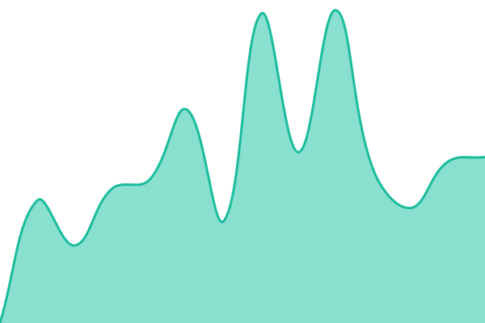

# [📈 Live Status](https://firatshipping32-debug.github.io/durum): <!--live status--> **🟩 All systems operational**

This repository contains the open-source uptime monitor and status page for [firatshipping32-debug](https://firatshipping32-debug.github.io/durum), powered by [Upptime](https://github.com/upptime/upptime).

With [Upptime](https://upptime.js.org), you can get your own unlimited and free uptime monitor and status page, powered entirely by a GitHub repository. We use [Issues](https://github.com/firatshipping32-debug/durum/issues) as incident reports, [Actions](https://github.com/firatshipping32-debug/durum/actions) as uptime monitors, and [Pages](https://firatshipping32-debug.github.io/durum) for the status page.

<!--start: status pages-->
<!-- This summary is generated by Upptime (https://github.com/upptime/upptime) -->
<!-- Do not edit this manually, your changes will be overwritten -->
<!-- prettier-ignore -->
| URL | Status | History | Response Time | Uptime |
| --- | ------ | ------- | ------------- | ------ |
|  [FGL uygulama (app.fglbelgium.com)](https://app.fglbelgium.com/login) | 🟩 Up | [fgl-uygulama-app-fglbelgium-com.yml](https://github.com/firatshipping32-debug/durum/commits/HEAD/history/fgl-uygulama-app-fglbelgium-com.yml) | 

 898ms
     
 | 

<a href="https://firatshipping32-debug.github.io/durum/history/fgl-uygulama-app-fglbelgium-com">100.00%</a>
    

|  [FGL web sitesi (fglbelgium.com)](https://fglbelgium.com) | 🟩 Up | [fgl-web-sitesi-fglbelgium-com.yml](https://github.com/firatshipping32-debug/durum/commits/HEAD/history/fgl-web-sitesi-fglbelgium-com.yml) | 

 1402ms
     
 | 

<a href="https://firatshipping32-debug.github.io/durum/history/fgl-web-sitesi-fglbelgium-com">100.00%</a>
    

|  [ContainerTransport](https://www.containertransport.io) | 🟩 Up | [container-transport.yml](https://github.com/firatshipping32-debug/durum/commits/HEAD/history/container-transport.yml) | 

 610ms
     
 | 

<a href="https://firatshipping32-debug.github.io/durum/history/container-transport">100.00%</a>
    

|  [Freightain](https://freightain.com) | 🟩 Up | [freightain.yml](https://github.com/firatshipping32-debug/durum/commits/HEAD/history/freightain.yml) | 

 915ms
     
 | 

<a href="https://firatshipping32-debug.github.io/durum/history/freightain">100.00%</a>
    

|  [KEY-ONE](https://keyone.orbitindustrial.com.tr/login.php) | 🟩 Up | [key-one.yml](https://github.com/firatshipping32-debug/durum/commits/HEAD/history/key-one.yml) | 

 1391ms
     
 | 

<a href="https://firatshipping32-debug.github.io/durum/history/key-one">100.00%</a>
    

|  [PILOTRUCKER uygulama](https://app.pilotrucker.ai) | 🟩 Up | [pilotrucker-uygulama.yml](https://github.com/firatshipping32-debug/durum/commits/HEAD/history/pilotrucker-uygulama.yml) | 

 844ms
     
 | 

<a href="https://firatshipping32-debug.github.io/durum/history/pilotrucker-uygulama">100.00%</a>
    

|  [PILOTRUCKER web sitesi](https://pilotrucker.ai) | 🟩 Up | [pilotrucker-web-sitesi.yml](https://github.com/firatshipping32-debug/durum/commits/HEAD/history/pilotrucker-web-sitesi.yml) | 

 649ms
     
 | 

<a href="https://firatshipping32-debug.github.io/durum/history/pilotrucker-web-sitesi">100.00%</a>
    

|  [Firat Global paneli](https://panel.firatglobal.com) | 🟩 Up | [firat-global-paneli.yml](https://github.com/firatshipping32-debug/durum/commits/HEAD/history/firat-global-paneli.yml) | 

 1936ms
     
 | 

<a href="https://firatshipping32-debug.github.io/durum/history/firat-global-paneli">100.00%</a>
    

|  [DENEME 2 (bilerek bozuk - silinecek)](https://fglbelgium.com) | 🟩 Up | [deneme-2-bilerek-bozuk-silinecek.yml](https://github.com/firatshipping32-debug/durum/commits/HEAD/history/deneme-2-bilerek-bozuk-silinecek.yml) | 

 1235ms
     
 | 

<a href="https://firatshipping32-debug.github.io/durum/history/deneme-2-bilerek-bozuk-silinecek">100.00%</a>
    

<!--end: status pages-->

[**Visit our status website →**](https://firatshipping32-debug.github.io/durum)

## 📄 License

- Powered by: [Upptime](https://github.com/upptime/upptime)
- Code: [MIT](./LICENSE) © [Anand Chowdhary](https://anandchowdhary.com)
- Data in the `./history` directory: [Open Database License](https://opendatacommons.org/licenses/odbl/1-0/)
